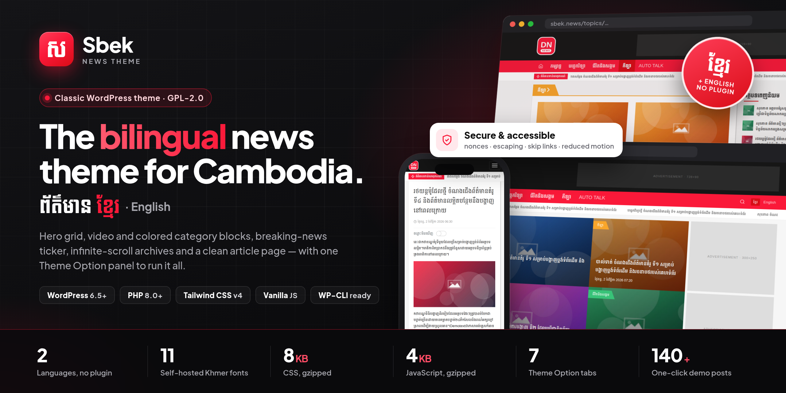

<p align="center">
  
</p>

# Sbek — bilingual news theme (Khmer / English)

A fast classic WordPress theme for a Khmer-first news site: black top bar and sticky menu, hero grid, video block, colored category blocks with "next" arrows, infinite-scroll archives with a list/grid switch, and a clean article page with a Khmer word-break toggle.

The project is two parts, so the theme can be listed on WordPress.org (which doesn't allow non-design features in themes):

| | What it does |
| --- | --- |
| **Sbek** (this repo, the theme) | Templates, design settings (colors, 11 Khmer fonts), homepage blocks, menus, widget areas, comments. Works on its own as a one-language site. |
| **[Sbek Companion](https://github.com/HELMAB/sbek-companion)** (plugin) | `/` Khmer + `/en/` English with linked translations, English texts and category names, news fields (video, source, sponsored, breaking, trending), share buttons, double opt-in newsletter, SEO / Open Graph / JSON-LD, analytics, login branding and lockout, query caching, demo content. |

## Features

- **Khmer primary, English secondary** (with the plugin): `/` is Khmer, `/en/` is English. Standard WordPress i18n plus `switch_to_locale()`, so theme strings, dates and core strings all follow the URL. Translations are linked post-to-post (hreflang + language switcher); categories have an English name.
- **Editorial controls:** sticky posts → hero; *Video* post format → video block; per-category accent color and homepage position; with the plugin, a trending score, a breaking-news ticker that expires on its own, a sponsored flag (labelled on every card), source name/URL, and one-click "create the English version" drafts.
- **Reader features:** breadcrumb, two-level menu with a "More" overflow, infinite scroll that hands over to a "Load more" button, threaded comments; with the plugin, share to Facebook / Telegram / X / email / copy link and a double opt-in newsletter.
- **Performance:** self-hosted Khmer font subsets, one deferred vanilla-JS file, about 10 KB gzipped CSS and 6 KB JS, responsive `srcset` images, hero images downloaded once on every viewport; the plugin adds ID-only transient caching with automatic invalidation.
- **Security:** nonces, capability checks and registered sanitizers on every write; escaped output; the plugin adds login lockout, optional hardening (security headers, XML-RPC and file editors off, hidden user list) and a throttled newsletter with a honeypot.
- **Accessible:** skip link, semantic headings, focus-visible styles, carousel hidden-slide handling with pause and slide buttons, a pause button on the ticker, announced pager and feed updates, reduced-motion support.

## Requirements

WordPress 6.5+, PHP 8.0+, Node 20+ (build only).

## Setup

```bash
cd wp-content/themes/sbek
nvm use && npm install && npm run build && npm run build:admin
wp theme activate sbek
git clone https://github.com/HELMAB/sbek-companion ../../plugins/sbek-companion
wp plugin activate sbek-companion   # optional: bilingual + plugin features
wp language core install km          # Khmer core strings (dates, comments, admin)
wp option update WPLANG km
```

Then:
1. Open **Appearance → Sbek Theme** and work through the tabs: logo and icon, brand colors and fonts (Design), homepage sections, category colors and order, contact details, socials. With the plugin: English texts, share image, newsletter, analytics, demo content.
2. Build the menus under **Appearance → Menus** (*Primary menu* and *Footer links*; with the plugin also the *(English)* locations). If the newsletter is on, make sure the site can send email.
3. Put ad code into the *Ad:* widget areas, if you use ads.

### Demo content (plugin)

Use **Appearance → Sbek Theme → Tools → Import demo content** (with a progress bar; **Remove demo content** undoes it), or:

```bash
wp sbek demo import       # categories, ~140 posts, images, menus, widgets, settings, permalinks
wp sbek demo reset --yes  # removes exactly what import created
wp sbek demo status
```

To go back to the original colors and fonts, use **Appearance → Sbek Theme → Design → Reset design to defaults**.

## Development

```bash
npm run watch          # front-end CSS
npm run watch:admin    # admin CSS
bin/release.sh         # checks + WordPress.org zip in dist/
```

See `CLAUDE.md` for the architecture: the theme/plugin split and its hooks, language routing, caching, templates and conventions.

## License

GNU General Public License v2 or later. Fonts: SIL Open Font License 1.1 (see `assets/fonts/`).
